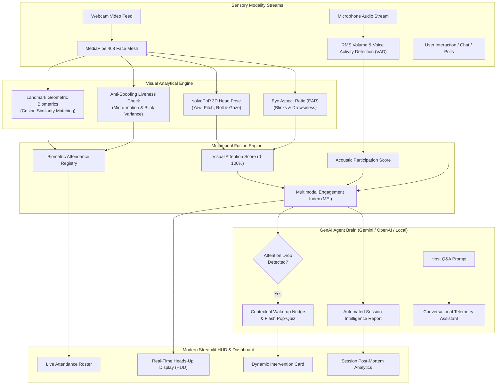

# 👁️ Multimodal Attendance & Engagement Agent

[](https://www.python.org/)
[](https://developers.google.com/mediapipe)
[](https://streamlit.io/)
[](https://ai.google.dev/)
[]()

> An autonomous, real-time multimodal intelligence system that tracks participant attendance, analyzes visual and acoustic engagement dynamics, prevents photo spoofing via liveness verification, and deploys proactive GenAI agent interventions to elevate audience retention in virtual classrooms, webinars, and meetings.

---

## 📌 Executive Overview

Traditional attendance systems rely on passive check-ins or manual roll calls, which are vulnerable to buddy-punching, static photo spoofing, and provide zero visibility into actual cognitive attentiveness. 

**Multimodal Attendance & Engagement Agent** solves this by harmonizing three real-time sensory streams:
1. **Visual Modality**: 3D Head Pose Estimation (Yaw, Pitch, Roll), Gaze Vector projection, Eye Aspect Ratio (EAR) drowsiness/fatigue monitoring, and Mouth Aspect Ratio (MAR) articulation.
2. **Acoustic Modality**: Voice Activity Detection (VAD) via microphone stream, measuring active verbal participation and question-asking time vs silent listening.
3. **Cognitive GenAI Agent**: Synthesizes multimodal telemetry in real-time to trigger contextual attention-reclaiming nudges, generate dynamic pop-quizzes, answer host questions, and formulate comprehensive post-session intelligence reports.

---

## 🏗️ System Architecture



---

## 🔬 Mathematical Formulations

### 1. Eye Aspect Ratio (EAR) for Drowsiness
Quantifies vertical eyelid aperture relative to horizontal eye width using 6 coordinates per eye:

$$\text{EAR} = \frac{\|p_2 - p_6\| + \|p_3 - p_5\|}{2 \cdot \|p_1 - p_4\|}$$

- When eyes are open: $\text{EAR} \approx 0.28 - 0.35$
- When eyes close / blink: $\text{EAR} < 0.21$
- If $\text{EAR} < 0.21$ for $\ge 15$ continuous frames, a **Drowsiness Event** is flagged.

### 2. 3D Head Pose & Gaze Vector (solvePnP)
Using canonical 3D facial landmarks (nose tip, chin, eye corners, mouth corners) and 2D camera coordinates:

$$s \begin{bmatrix} u \\ v \\ 1 \end{bmatrix} = \mathbf{K} \begin{bmatrix} \mathbf{R} & \mathbf{t} \end{bmatrix} \begin{bmatrix} X_w \\ Y_w \\ Z_w \\ 1 \end{bmatrix}$$

Using Levenberg-Marquardt optimization via `cv2.solvePnP()`, the system calculates the rotation matrix $\mathbf{R}$ and derives Euler angles:
- **Yaw ($\psi$)**: Horizontal turning left/right ($[-25^\circ, +25^\circ]$ considered on-screen focus).
- **Pitch ($\theta$)**: Vertical looking up/down ($[-20^\circ, +20^\circ]$ considered on-screen focus).
- **Roll ($\phi$)**: Lateral head tilt.

### 3. Multimodal Engagement Index (MEI)
$$MEI = w_v \cdot S_{\text{visual}} + w_a \cdot S_{\text{acoustic}} + w_i \cdot S_{\text{interactive}}$$

Where default weights are $w_v = 0.70$, $w_a = 0.20$, and $w_i = 0.10$.

### 4. Anti-Spoofing Liveness Verification
Still photos or printed masks lack biological micro-movements. The agent checks standard deviation over a sliding window $W$:

$$\sigma_{\text{EAR}} = \text{std}(\text{EAR}_W), \quad \sigma_{\text{Pose}} = \text{std}(\mathbf{\Theta}_W)$$

If $\sigma_{\text{EAR}} > 0.006$ or $\sigma_{\text{Pose}} > 0.35^\circ$, liveness is confirmed as **Verified Real Person**.

---

## ✨ Key Features

| Category | Capability |
| :--- | :--- |
| **Biometric Attendance** | Facial landmark geometric identification, automated check-in/out logging, duration tracking, anti-spoofing verification. |
| **Gaze & Focus HUD** | 3D gaze vector projection arrow originating from the nose, real-time attention gauge, EAR and Head Pose telemetry. |
| **Acoustic Monitoring** | Microphone capture via `sounddevice`, real-time RMS audio level meter, voice activity detection, vocal participation ratio. |
| **GenAI Interventions** | Automated polite wake-up nudges and dynamic 4-choice pop-quizzes generated on demand. |
| **Post-Mortem Reports** | One-click comprehensive Markdown report synthesis with engagement grades (A+, B, etc.), timeline hotspots, and pedagogical tips. |
| **Interactive AI Chat** | Conversational agent capable of answering natural-language queries about session dynamics and individual attendee performance. |
| **Zero-Setup Offline Mode** | Works 100% locally out-of-the-box with a built-in cognitive heuristic agent; optionally connects to Google Gemini, OpenAI, or Groq APIs. |

---

## 📂 Project Directory Structure

```
Multimodal-Attendance-Engagement-Agent/
│
├── app.py                      # Main interactive Streamlit application
├── run.bat                     # 1-Click Windows execution script
├── requirements.txt            # Python dependencies
├── .env.example                # Sample environment configuration for API keys
├── README.md                   # Complete architectural documentation
│
├── core/                       # Core analytical & AI engines
│   ├── __init__.py
│   ├── engagement_analyzer.py  # 3D Head Pose, solvePnP, EAR, MAR, attention scoring
│   ├── face_recognizer.py      # Face signature extraction, cosine matching, liveness
│   ├── audio_analyzer.py       # Microphone stream capture, RMS volume, VAD
│   ├── multimodal_fusion.py    # Temporal fusion of vision + audio + interaction metrics
│   └── genai_agent.py          # Gemini REST API, OpenAI API, and Offline Local Agent
│
├── tests/                      # Automated test suite
│   └── test_pipeline.py        # End-to-end integration tests for all modules
│
├── utils/                      # Helper utilities
│   ├── __init__.py
│   ├── visualizer.py           # Futuristic OpenCV HUD rendering with gaze arrows
│   └── export_helpers.py       # Attendance CSV & Markdown report exporters
│
└── data/                       # Local database & storage
    ├── profiles/               # Registered participant JSON profiles & avatar photos
    └── sessions/               # Saved session logs, CSVs, and generated reports
```

---

## 🚀 Quickstart Guide

### 1. Prerequisites
- **Operating System**: Windows 10/11 (or macOS / Linux)
- **Python**: 3.10+ (Python 3.11 pre-installed)
- **Webcam & Microphone**: Required for live camera capture (or use the built-in *Simulated Demo Stream*).

### 2. Launch the Application

#### Option A: One-Click Windows Launch
Double-click `run.bat` in the project folder.

#### Option B: Terminal Command
```powershell
# From the project directory:
"C:\Users\ayush\AppData\Local\Programs\Python\Python311\python.exe" -m streamlit run app.py
```
Or if Python is in your system PATH:
```bash
streamlit run app.py
```

Open your browser to: **`http://localhost:8501`**

---

## 🧪 Automated Testing & Verification

Run the comprehensive integration test suite to verify all pipeline components:
```powershell
"C:\Users\ayush\AppData\Local\Programs\Python\Python311\python.exe" tests/test_pipeline.py
```
Expected output:
```
🚀 Starting Multimodal Pipeline Verification...
Testing EngagementAnalyzer...
✅ EngagementAnalyzer passed!
Testing FaceRecognizer...
✅ FaceRecognizer passed! Similarity: 1.0
Testing AudioAnalyzer...
✅ AudioAnalyzer passed!
Testing MultimodalFusionEngine...
✅ MultimodalFusionEngine passed!
Testing GenAIAgent...
✅ GenAI Intervention Nudge generated!
✅ GenAI Pop-Quiz generated!
✅ GenAI Post-Mortem Report generated successfully!
Testing Visualizer HUD...
✅ Visualizer HUD passed!
Testing Exporters...
✅ Exporters passed!

🎉 ALL PIPELINE INTEGRATION TESTS PASSED 100%!
```

---

## 🎓 Presentation & Viva Q&A Guide

### Q1: What makes this project "Multimodal"?
> **Answer**: It fuses three distinct sensory modalities simultaneously:
> 1. **Visual Modality**: 3D face mesh, head rotation angles (Yaw, Pitch, Roll), gaze vector, and eye closure (EAR).
> 2. **Acoustic Modality**: Real-time microphone RMS volume levels and Voice Activity Detection (VAD) measuring verbal participation time.
> 3. **Interactive / Text Modality**: In-session chat participation, dynamic pop-quizzes, and host Q&A.

### Q2: How does the system prevent someone from holding a printed photograph (spoofing)?
> **Answer**: Through **Liveness Verification**. A photograph or still image displayed on a phone screen has near-zero standard deviation in Eye Aspect Ratio ($\sigma_{\text{EAR}} \approx 0$) and zero micro-head rotation variance ($\sigma_{\text{Pose}} \approx 0$). The anti-spoofing module analyzes temporal variance across a sliding window to verify natural human biological micro-motions before authenticating.

### Q3: How is GenAI integrated into this system?
> **Answer**: GenAI acts as the **Cognitive Agent Brain**:
> 1. It monitors the Multimodal Engagement Index (MEI). When attention decay is detected, it generates **personalized, contextual wake-up nudges**.
> 2. It crafts **dynamic topic-specific pop-quizzes** on the fly to test audience comprehension.
> 3. It synthesizes full session telemetry into an **Executive Post-Mortem Intelligence Report** complete with letter grades, attention heatmaps, and pedagogical recommendations.
> 4. It powers an **interactive conversational agent** allowing the host to ask natural language questions about session dynamics.

---

## 📄 License
MIT License. Built for advanced Generative AI and Multimodal Computer Vision research.
